# STM32 OLED 显示与 U8g2 移植实验报告

> 课程作业：第 6 周作业 —— OLED 显示、汉字点阵与 U8g2 图形库移植
> 开发板：STM32F103C8T6 最小系统板（Blue Pill）
> 显示屏：中景园 0.96 寸 OLED（SSD1306，128×64，I2C 四针）
> 工程名：`OLED_U8g2_Task`
> 姓名 / 学号：蒋俊熙 / 632407030418
> 日期：2026 年 10 月

---

## 一、实验目的

1. 了解 I2C 协议的基本原理和时序协议，理解起始、停止、应答、7 位地址等概念。
2. 掌握 0.96 寸 OLED 屏（SSD1306）的工作原理，以及汉字点阵的编码与显示原理。
3. 掌握开源 GUI 库 **U8g2** 在 STM32 上的移植、编译方法，以及图形界面可视化技术。
4. 完成任务 1（学号姓名、长字符串滚动）与任务 3（CubeMX + HAL 框架、U8g2 裁剪移植、图形与滚动演示、头像动画），并回答思考题。

> **报告范围**：任务 2（AHT20 温湿度）因手头没有传感器本次不做，报告只包含任务 1 和任务 3；工程中保留的 AHT20 驱动与占位页不在本报告范围内。

---

## 二、实验环境与硬件连接

### 2.1 实验环境

| 项目 | 说明 |
| --- | --- |
| MCU | STM32F103C8T6（Cortex-M3，64 KB Flash / 20 KB RAM，LQFP48） |
| 系统时钟 | HSE 8 MHz × PLL9 = **72 MHz**；APB1 = 36 MHz，APB2 = 72 MHz |
| 显示屏 | 中景园 0.96 寸 OLED，驱动芯片 SSD1306，128×64 单色，4 针 I2C |
| 下载 / 调试 | DAP-Link（CMSIS-DAP，SWD：SWDIO-PA13、SWCLK-PA14） |
| 开发工具 | STM32CubeMX 6.18.1、Keil MDK-ARM 5.24（ARMCC V5.06 update 5） |
| 固件库 | STM32Cube FW_F1 V1.8.7（HAL 库） |
| 图形库 | u8g2（裁剪后移植，见 3.4 节） |
| 工程 | `STM/work/6/OLED_U8g2_Task.ioc` + `MDK-ARM/OLED_U8g2_Task.uvprojx` |

### 2.2 硬件连接

OLED 模块有 4 个引脚（模块丝印 `GND / VCC / SCL / SDA`），供电 3.3 V，模块自带 4.7 kΩ 上拉电阻，直接接到 STM32 的 I2C1 上即可：

| OLED 引脚 | STM32F103C8T6 | 说明 |
| --- | --- | --- |
| GND | GND | 共地 |
| VCC | 3V3 | **必须 3.3 V**，不要接 5 V |
| SCL | **PB6** | I2C1_SCL，复用开漏 |
| SDA | **PB7** | I2C1_SDA，复用开漏 |

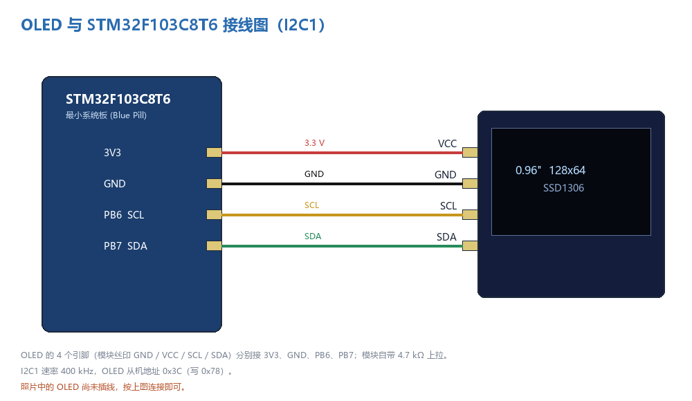

*图 2-1　OLED 与 STM32F103C8T6 的 I2C 接线*

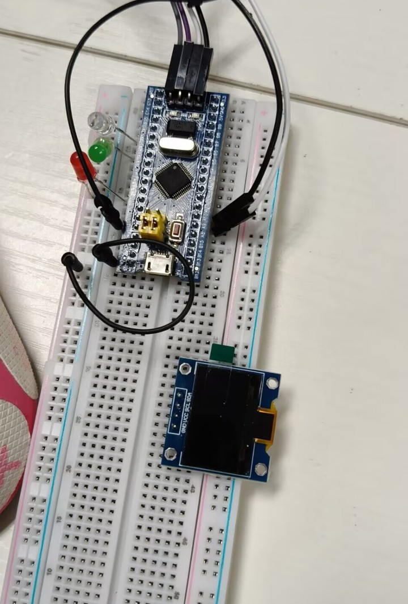

*图 2-2　实验用 STM32F103C8T6 最小系统板与 0.96 寸 OLED 模块（照片中 OLED 尚未插线，按图 2-1 连接）*

> 说明：PB6/PB7 是 STM32F103 的 I2C1 默认引脚，不需要重映射；CubeMX 中把这两个引脚配置为 `I2C1_SCL / I2C1_SDA` 即可。若使用 PB8/PB9，则需要在 CubeMX 中开启 I2C1 Remap 并重新生成代码。

### 2.3 系统框图

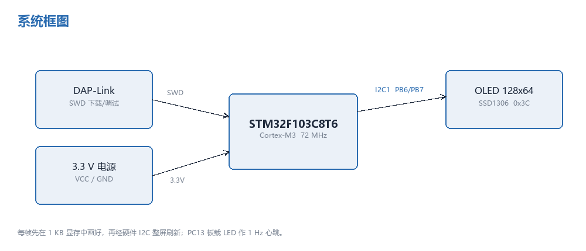

*图 2-3　系统框图：MCU 通过 I2C1 驱动 OLED，DAP-Link 负责下载调试*

---

## 三、实验原理

### 3.1 OLED 与 SSD1306

0.96 寸 OLED 模块由 **SSD1306** 驱动芯片、128×64 的单色 OLED 面板和外围升压电路组成。SSD1306 内部有一块 **1 KB 的显示 RAM（GDDRAM）**，它把屏幕按“页”组织：

- 横向 128 列（column 0…127），纵向 64 行分成 **8 页（page 0…7）**，每页 8 行；
- 每个字节对应“某一页、某一列”的 8 个垂直像素，**bit0 在上、bit7 在下**；
- 因此整屏 = 8 × 128 = 1024 字节 = 1 KB。

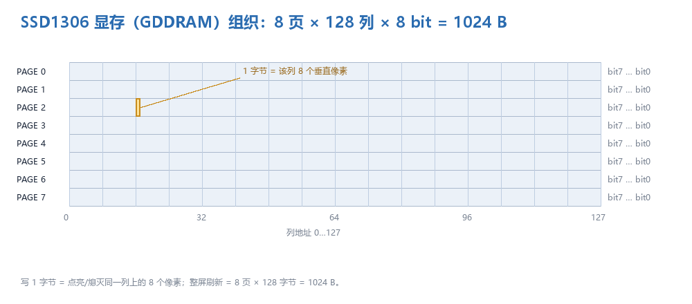

*图 3-1　SSD1306 的 GDDRAM 组织：写 1 字节就是写同一列上的 8 个像素*

主机不需要（也不能）逐像素控制 OLED，只需要把 1 KB 的显存内容按页写进去。SSD1306 的 I2C 从机地址由 SA0 引脚决定，模块默认 **0x3C**（8 位写地址 0x78）。每次 I2C 传输的第一个字节是**控制字节**：

| 控制字节 | 含义 |
| --- | --- |
| `0x00` | 后续字节是**命令**（如设置页地址、对比度、开关显示） |
| `0x40` | 后续字节是**显存数据** |

初始化时写入的典型命令序列（u8g2 的 `u8x8_d_ssd1306_128x64_noname` 会发送其中的大部分）：

| 命令 | 作用 |
| --- | --- |
| `AE` / `AF` | 关显示 / 开显示 |
| `D5 80` | 时钟分频 |
| `A8 3F` | 多路复用比 = 64 |
| `D3 00` | 显示偏移 = 0 |
| `40` | 显示起始行 = 0 |
| `8D 14` | 开启内部电荷泵（3.3 V 升压到约 7.5 V） |
| `20 00` | 水平寻址模式 |
| `A1` / `C8` | 段重映射 / COM 扫描方向（决定屏幕方向） |
| `DA 12` | COM 引脚硬件配置 |
| `81 CF` | 对比度 |
| `D9 F1` | 预充电周期 |
| `DB 40` | VCOMH 电压 |
| `A4` / `A6` | 显示跟随 RAM / 正常显示（非反白） |

### 3.2 I2C 协议

I2C 是两线制同步串行总线：**SCL**（时钟）和 **SDA**（数据），两条线都是开漏输出，必须接上拉电阻（OLED 模块已自带）。总线上的器件通过 7 位地址区分，主机发起传输。

一次“写”传输的格式为：

```
START → 从机地址(7 bit) + W(0) → ACK → 控制字节 → ACK → 数据… → ACK → STOP
```

- **START**：SCL 为高时，SDA 由高变低；
- **STOP**：SCL 为高时，SDA 由低变高；
- **数据有效**：SCL 为高电平期间 SDA 必须稳定，数据只能在 SCL 低电平期间改变；
- **ACK**：每传输 8 位数据后的第 9 个时钟，接收方把 SDA 拉低表示应答。

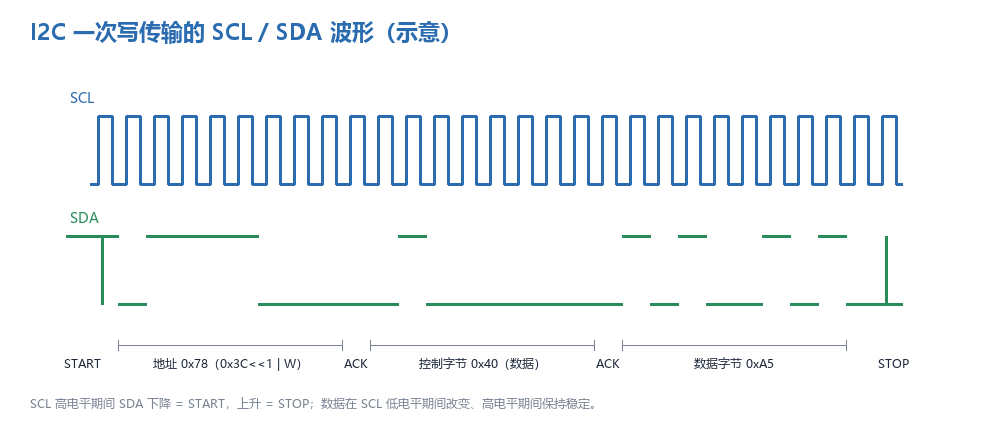

*图 3-2　I2C 写传输的 SCL/SDA 波形（示意）：地址 0x78、控制字节 0x40、数据 0xA5*

本实验使用 **400 kHz 快速模式**：SCL 周期 2.5 µs，一个字节（8 位 + 1 位应答）= 9 个时钟 ≈ 22.5 µs。若用 100 kHz 标准模式，传输同样 1 KB 数据要 90 ms 以上，整屏刷新会明显变慢，所以工程里把 I2C1 配置为 400 kHz（SSD1306 支持 400 kHz）。HAL 库中使用阻塞式 API：

```c
HAL_I2C_Master_Transmit(&hi2c1, 0x78, buf, len, 100);
HAL_I2C_Master_Receive (&hi2c1, 0x79, buf, len, 100);
```

`0x78` 是 8 位写地址（0x3C << 1），HAL 要求传入的地址已经左移。

### 3.3 汉字点阵与字库

#### 3.3.1 汉字点阵

LCD/OLED 显示汉字的基本原理是**点阵**：把一个汉字放进 16×16 的方格，有笔画的地方为 1、空白为 0，就得到 256 个二进制位，即 **32 字节**。取模软件（如 PCtoLCD2002）按“逐行式、高位在前”把每个字节算出来，C 数组就是字模。

以字库中的“蒋”字为例（该字在 12 px 字号下实际墨迹为 15×16）：

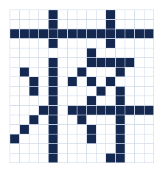

*图 3-3　“蒋”字的点阵（每一小格是一个像素）*

如果按 16×16、每行 2 字节存储，那么第 1 行就是 `0x08 0x00` 这样的两个字节，依次写 16 行即可。显示时把字模按行“画”到显存的对应位置：字节的 bit7 对应最左像素，逐位判断 0/1 决定点亮还是熄灭。

#### 3.3.2 u8g2 的字库格式

u8g2 不使用“整个汉字固定 32 字节”的原始点阵，而是使用一种压缩格式：

- 每个字形单独记录**宽、高、x/y 偏移、步进（delta x）**，再用 RLE（游程编码）压缩位图；
- 只把用到的字符编译进工程，未用到的字符不占空间。

本工程使用的是从文泉驿 12 px 点阵字体裁剪出的 **wqy12 子集**：共 **141 个字形**（95 个 ASCII + 46 个汉字/符号），字库数据只有 **3.3 KB**。而完整的文泉驿字库有 4 万多个字形，全部编译要几百 KB Flash，对 64 KB 的 STM32F103C8T6 来说是不可接受的。

| 字库 | 字形数 | 数据大小 | 说明 |
| --- | --- | --- | --- |
| 完整文泉驿 12 px | 41295 | 数百 KB | 不可用于本芯片 |
| `u8g2_font_wqy12_cn`（本工程） | 141 | 3.3 KB | 只保留界面用到的字 |
| `u8g2_font_7x14B_ascii` | 95 | 1.1 KB | 标题、标签 |
| `u8g2_font_10x20_ascii` | 95 | 2.0 KB | 学号、数值 |

> 注意：字库是“按需裁剪”的，界面里不能出现字库之外的字符。例如全角逗号 `，`、感叹号 `！` 都不在子集里，所以程序里用 `,`、`!` 代替；如果要显示新的汉字，必须重新生成字库（`bdfconv` 工具，见 3.3.3）。

#### 3.3.3 字库裁剪与字符集

用 u8g2 自带的 `bdfconv`，把 BDF 字体转成 C 数组，并用 `-M` 指定字符映射文件，只保留界面用到的字符：

```text
bdfconv -f 1 -m "32-127,20320,22909,..." -n u8g2_font_wqy12_cn \
        -o u8g2_font_wqy12_cn.c wenquanyi_12pt.bdf
```

本工程涉及的汉字/符号（46 个）：

```text
上 业 举 乡 交 低 作 你 俊 光 到 前 号 名 地 大 头 好 姓 学 实 室 庆 床 度
思 故 明 是 月 望 来 欢 温 湿 熙 物 疑 网 联 蒋 训 迎 通 重 霜
```

可以看出它们刚好覆盖：姓名“蒋俊熙”、标签“温度/湿度/学号”、长句“你好，欢迎来到重庆交通大学物联网205实训室！”以及《静夜思》的四句诗。`docs/tools/fontcheck.py` 可以在编译前检查界面文本是否越界（有缺字会直接报出来）。

### 3.4 U8g2 的结构与移植

#### 3.4.1 分层结构

u8g2 分为两层：

| 层 | 作用 | 本工程对应文件 |
| --- | --- | --- |
| **u8x8** | 最底层的“字节/引脚”抽象：把命令和数据送到屏幕；负责初始化序列、I2C/SPI 时序 | `u8x8_byte.c`、`u8x8_cad.c`、`u8x8_d_ssd1306_128x64_noname.c` |
| **u8g2** | 图形层：画点、线、框、圆、位图、字符串，管理显存和字体 | `u8g2_*.c`、`u8g2_font.c`、字库文件 |

移植的本质，就是实现 u8x8 要求的两个回调函数：

1. **byte 回调**：处理 `START / SEND / END` 三种消息，把字节真正写到 I2C 上；
2. **gpio & delay 回调**：处理复位引脚和毫秒/微秒延时（I2C 模式没有复位引脚，只需要延时）。

#### 3.4.2 初始化与显存模式

本工程使用**全屏缓冲模式**（函数名以 `_f` 结尾）：

```c
u8g2_Setup_ssd1306_i2c_128x64_noname_f(&u8g2, U8G2_R0,
                                       OLED_ByteCb, OLED_GpioDelayCb);
u8g2_InitDisplay(&u8g2);
u8g2_SetPowerSave(&u8g2, 0);
u8g2_ClearBuffer(&u8g2);
u8g2_SendBuffer(&u8g2);
```

- `_f` 模式在 RAM 中分配 **1 KB** 的显存，所有绘图操作只改 RAM，最后 `u8g2_SendBuffer()` 一次性把 1 KB 写到屏幕；
- 相比 `_1`/`_2`（页缓冲）模式，整屏刷新不会出现“上半屏新、下半屏旧”的撕裂和闪烁，代价是 1 KB RAM。STM32F103C8T6 有 20 KB RAM，完全够用。

#### 3.4.3 移植代码

`Core/Src/oled_port.c` 中的字节回调：

```c
static uint8_t OLED_ByteCb(u8x8_t *u8x8, uint8_t msg, uint8_t arg_int, void *arg_ptr)
{
  uint8_t *src = (uint8_t *)arg_ptr;

  switch (msg)
  {
    case U8X8_MSG_BYTE_INIT:
      break;                       /* I2C1 已由 MX_I2C1_Init() 初始化 */

    case U8X8_MSG_BYTE_START_TRANSFER:
      s_tx_len = 0U;
      s_tx_buf[s_tx_len++] = (uint8_t)u8x8_GetI2CAddress(u8x8);  /* 0x78 */
      break;

    case U8X8_MSG_BYTE_SEND:
      while ((arg_int-- > 0U) && (s_tx_len < I2C_TX_MAX))
        s_tx_buf[s_tx_len++] = *src++;
      break;

    case U8X8_MSG_BYTE_END_TRANSFER:
      if (s_tx_len > 1U)
        (void)HAL_I2C_Master_Transmit(&hi2c1, s_tx_buf[0],
                                      &s_tx_buf[1], s_tx_len - 1U, 100U);
      s_tx_len = 0U;
      break;

    default:
      return 0U;
  }
  return 1U;
}
```

要点：

- u8g2 的 SSD1306 I2C 驱动把数据切成 **最多 24 字节**的小块，每块单独发起一次 I2C 传输（START → 地址 → 控制字节 0x40 → 数据 → STOP）。因此 64 字节的发送缓冲足够，不会截断；
- 地址从 `u8x8_GetI2CAddress()` 取得，是已经左移的 8 位形式（0x78），正好是 HAL 需要的格式；
- 延时回调里 `U8X8_MSG_DELAY_MILLI` 用 `HAL_Delay()`，`10MICRO` 用空循环，`100NANO`/`NANO` 忽略。

#### 3.4.4 裁剪清单

为了控制 Flash 占用，只把用得到的源文件加入 Keil 工程（共 28 个 .c 文件）：

| 分组 | 文件 |
| --- | --- |
| u8g2 核心 | `u8g2_setup.c`、`u8g2_buffer.c`、`u8g2_hvline.c`、`u8g2_ll_hvline.c`、`u8g2_intersection.c`、`u8g2_cleardisplay.c` |
| 基本图形 | `u8g2_box.c`、`u8g2_line.c`、`u8g2_circle.c`、`u8g2_arc.c`、`u8g2_bitmap.c` |
| 字体 | `u8g2_font.c` + 3 个字库文件 |
| 显示驱动 | `u8g2_d_setup.c`（只保留 SSD1306 128×64 I2C）、`u8g2_d_memory.c`（只保留 128/256/1024 字节三种缓冲） |
| u8x8 底层 | `u8x8_setup.c`、`u8x8_display.c`、`u8x8_byte.c`、`u8x8_cad.c`、`u8x8_gpio.c`、`u8x8_8x8.c`、`u8x8_capture.c`、`u8x8_d_ssd1306_128x64_noname.c`、`u8x8_u8toa.c`、`u8x8_u16toa.c` |
| 补充 | `u8g2_kerning.c`（裁剪版缺少两个 kerning 函数，补空实现） |

`u8g2_d_setup.c` 原本包含几十种屏幕的初始化函数，裁剪后只保留 `u8g2_Setup_ssd1306_i2c_128x64_noname_1/2/f` 三个；`u8g2_d_memory.c` 只保留对应尺寸的显存分配函数。这样既减小 Flash，也避免链接进无关驱动。

### 3.5 滚动显示的两种实现

题目要求“上下或左右滑动显示长字符串，最好使用硬件刷屏模式”。这里先把两种“滚动”讲清楚：

#### 3.5.1 SSD1306 的硬件滚动

SSD1306 内部有硬件滚动功能，主机只需发命令，屏幕就会自己滚动，不占用 CPU 和总线：

| 命令 | 作用 |
| --- | --- |
| `26/27` | 水平向右/向左滚动（参数：空字节、起始页、间隔、结束页、空字节） |
| `29/2A` | 垂直 + 水平滚动 |
| `2E` / `2F` | 关闭 / 开启滚动 |

它滚动的对象是**屏幕自己的 128 列 GDDRAM**，滚动时整个 RAM 窗口循环移动。这带来两个限制：

1. 只能滚动“已经在屏幕里”的内容，**无法容纳超过 128 像素宽的长句**——本工程的长句有 328 像素，硬件滚动装不下；
2. 滚动是整屏行为，会把标题、状态栏一起卷走，不适合“上面固定标题、下面滚动字幕”的界面。

#### 3.5.2 本工程的实现

长句采用“**字模条 + 列偏移整屏刷新**”的软件滚动，但仍然是“硬件刷屏”：

- 在 PC 端把整句“你好，欢迎来到重庆交通大学物联网205实训室！”按 u8g2 字库渲染成一条 **328×16 的点阵条**，以 SSD1306 的页格式（每列 2 字节）存进 Flash，共 656 字节（`ui_assets.c`）；
- 每帧计算偏移 `x0 = 128 - (t × 60/1000) % (328+128)`，把点阵条的第 `x` 列直接写进 u8g2 显存的第 4、5 页（y = 32…47）的 `x0+x` 列；
- 最后 `u8g2_SendBuffer()` 用硬件 I2C 一次刷整屏（不是软件模拟 I2C，也不是逐页反复刷）。

这样既做到了 60 像素/秒的平滑左移，又只需要 1 KB 显存，不需要额外的 328×16 大缓冲。

```c
static void UI_MarqueeStrip(u8g2_t *u8g2, int16_t x0)
{
  uint8_t *buf = u8g2_GetBufferPtr(u8g2);
  uint16_t x;

  for (x = 0U; x < ui_marquee_width; x++)
  {
    int16_t dx = (int16_t)x + x0;
    if ((dx < 0) || (dx >= 128)) continue;
    buf[4U * 128U + dx] = ui_marquee_strip[x * 2U];       /* y = 32..39 */
    buf[5U * 128U + dx] = ui_marquee_strip[x * 2U + 1U];  /* y = 40..47 */
  }
}
```

竖直滚动（《静夜思》四句）则用 u8g2 的文本接口：每次把四句的基线整体上移，配合 `u8g2_SetClipWindow()` 把标题下方的区域裁出来，超出标题的部分自动被裁掉。由于 y 坐标始终为正（只有当一行完全离开屏幕才跳过绘制），不存在负坐标被无符号数“回绕”的问题。

> 关于“硬件刷屏”：本工程每一帧都是先在 1 KB 显存里画好，再用 **硬件 I2C 外设 + 整屏一次性刷新**，这与“软件模拟 I2C + 逐页刷”相比，既快又不会闪。真正意义上的“SSD1306 硬件滚动”在上面已说明其局限，因此没有用于 328 像素的长句。

### 3.6 刷新时间与帧率估算

一帧要传 1024 字节显存数据，再加每 24 字节一块的控制字节和地址开销，约 **10.2 kbit**：

```text
t_frame ≈ (1024 × 9 + 43 × 18) / 400000 ≈ 25 ms
```

工程把帧间隔设为 **40 ms（25 fps）**，总线占用约 63%。若用 100 kHz，则一帧约 100 ms，只有 10 fps，滚动会明显卡顿——这也是必须把 I2C 提到 400 kHz 的原因。

---

## 四、系统设计

### 4.1 CubeMX 配置

| 项目 | 配置 |
| --- | --- |
| RCC | HSE 8 MHz 晶振，PLL ×9 → SYSCLK 72 MHz，AHB /1，APB1 /2（36 MHz），APB2 /1（72 MHz） |
| I2C1 | 400 kHz，7 位地址，双地址关闭，时钟延展允许 |
| GPIO | PB6 = I2C1_SCL，PB7 = I2C1_SDA（复用开漏、高速）；PC13 = LED 输出（初始高电平 = 灭） |
| SYS | SWD（PA13/PA14），SysTick 1 ms |
| 工程 | MDK-ARM V5，HAL 库，`Core/Inc`、`Core/Src` 标准结构 |

CubeMX 默认生成的 I2C 速率是 100 kHz；本工程在 `MX_I2C1_Init()` 中把 `ClockSpeed` 改为 **400000**（也可以在 CubeMX 的 I2C1 参数里直接设为 400 kHz 再生成）：

```c
hi2c1.Instance = I2C1;
hi2c1.Init.ClockSpeed = 400000;
hi2c1.Init.DutyCycle = I2C_DUTYCYCLE_2;
hi2c1.Init.OwnAddress1 = 0;
hi2c1.Init.AddressingMode = I2C_ADDRESSINGMODE_7BIT;
...
```

### 4.2 工程结构

```text
OLED_U8g2_Task/
├── OLED_U8g2_Task.ioc              # CubeMX 配置
├── Core/
│   ├── Inc/                        # main.h / hal_conf / it.h
│   │   ├── app.h                   # 应用入口
│   │   ├── ui.h                    # 五个页面的绘制接口
│   │   ├── ui_assets.h             # 头像 + 滚动字模条
│   │   ├── ui_text.h               # 中文文本（UTF-8 转义，自动生成）
│   │   └── oled_port.h             # u8g2 移植层
│   └── Src/
│       ├── main.c                  # CubeMX 生成 + App_Init/App_Task
│       ├── app.c                   # 页面状态机、帧率控制
│       ├── ui.c                    # 五个页面的绘图代码
│       ├── ui_assets.c             # 64×64 头像、328×16 字模条（自动生成）
│       └── oled_port.c             # u8g2 → HAL I2C 回调
├── Middlewares/u8g2/               # u8g2 源码（裁剪）
│   └── fonts/                      # 7x14B / 10x20 / wqy12 子集
├── Drivers/                        # CMSIS + STM32F1xx HAL
├── MDK-ARM/
│   ├── OLED_U8g2_Task.uvprojx      # Keil 工程
│   └── OLED_U8g2_Task/             # 编译产物（.hex/.axf）
└── docs/
    ├── STM32_OLED_U8g2实验报告.md   # 本报告 Markdown 源码
    ├── STM32_OLED_U8g2实验报告.pdf  # 本报告 PDF
    ├── images/                     # 全部插图
    └── tools/                      # 字库检查、字模/头像生成、插图脚本
```

### 4.3 页面状态机

程序上电后先初始化时钟、GPIO、I2C1 和 OLED，然后进入 `while(1)` 调用 `App_Task()`。`App_Task()` 每 40 ms 处理一帧：清空显存 → 根据当前页调用对应的 `UI_*` 函数 → `OLED_Refresh()` 整屏发送；同时累计本页显示时间，到时间就切到下一页。

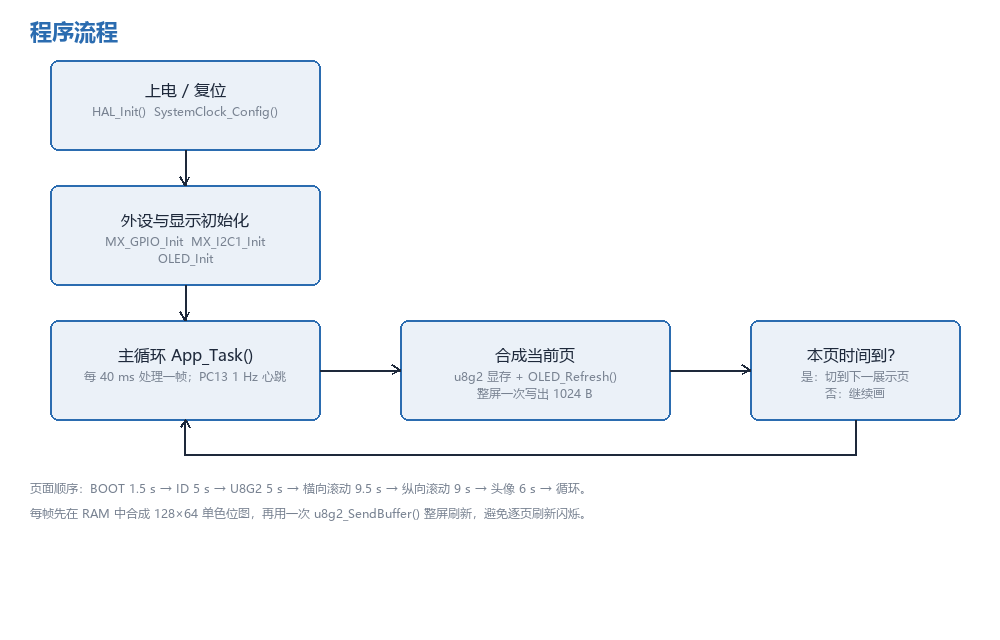

*图 4-1　程序流程与页面切换*

| 页面 | 内容 | 显示时间 |
| --- | --- | --- |
| BOOT | 启动画面：边框、`U8g2`、芯片型号、进度条 | 1.5 s |
| ID CARD | 姓名（2 倍字号）+ 12 位学号 | 5 s |
| U8G2 DEMO | u8g2 图形演示：文字、圆、圆盘、旋转线、柱状条 | 5 s |
| HELLO | 长句左右滚动（328 px 字模条） | 9.5 s |
| POEM | 《静夜思》四句上下滚动 | 9 s |
| AVATAR | 64×64 头像滑入 + 眨眼，右侧姓名/学号 | 6 s |

### 4.4 关键代码

#### 4.4.1 应用主循环

```c
void App_Task(void)
{
  uint32_t now = HAL_GetTick();

  if ((now - s_last_frame) < 40U) return;      /* 25 fps */
  s_last_frame = now;

  t = now - s_page_start;
  if (t >= kDuration[s_screen])                /* 本页时间到 */
  {
    s_screen = (s_screen + 1U) % SCR_COUNT;
    s_page_start = now;
  }

  u8g2_ClearBuffer(&u8g2);
  switch (s_screen) { /* 调用对应的 UI_* 函数 */ }
  OLED_Refresh();                              /* 整屏 I2C 刷新 */

  if (now - s_last_led >= 500U)                /* 1 Hz 心跳 */
  {
    s_last_led = now;
    HAL_GPIO_TogglePin(LED_GPIO_Port, LED_Pin);
  }
}
```

#### 4.4.2 中文文本的编码处理

这是一个容易被忽略、但在 Keil 下必踩的坑：**ARMCC V5 默认按 Windows 本地代码页（GBK）读取源文件**。如果源文件是 UTF-8，`"蒋俊熙"` 的 9 个字节会被当成 4 个半 GBK 汉字，最后一个字节还会“吃掉”后面的引号，编译时报 `#8: missing closing quote`，甚至把后面的代码一起吞掉。

解决办法是让 C 源文件保持 **纯 ASCII**，中文用 UTF-8 字节转义写入（`\xE8\x92\x8B` 就是“蒋”），再交给 u8g2 按 UTF-8 解析：

```c
/* Core/Inc/ui_text.h，由 docs/tools/gen_text.py 自动生成 */
#define UI_TXT_NAME  "\xE8\x92\x8B\xE4\xBF\x8A\xE7\x86\x99"  /* 蒋俊熙 */
```

真正的中文只保存在 `gen_text.py`（Python 源文件，UTF-8）里，改完文字重新运行脚本即可，既不会乱码，也方便在 GitHub 上查看。

#### 4.4.3 头像与动画

头像是 64×64 的 1 位位图（512 字节，`ui_assets.c` 自动生成）。上电进入该页时，先让位图从 x=128 滑到 x=0（600 ms 缓动），停稳后每 2.4 s 用两条黑色横线盖住镜片内部 160 ms，形成“眨眼”效果；右侧显示姓名和分段学号。

### 4.5 编译与下载

- Keil 中打开 `MDK-ARM/OLED_U8g2_Task.uvprojx`，F7 编译；
- 命令行编译：

```powershell
$uv = 'C:\Users\Administrator\Desktop\STM\UV4\UV4.exe'
Start-Process $uv -ArgumentList @('-r', 'MDK-ARM\OLED_U8g2_Task.uvprojx',
                                  '-j0', '-o', 'build.log') -Wait
```

- 下载：DAP-Link 接 SWD（3V3、GND、SWDIO-PA13、SWCLK-PA14），Keil 选 CMSIS-DAP 下载；也可以用 FlyMcu 通过串口 ISP 下载（BOOT0 接 3V3，复位后下载）。

---

## 五、实验步骤

1. **CubeMX 建工程**：选 STM32F103C8T6，配置 HSE + PLL9 = 72 MHz；开 I2C1（PB6/PB7，生成后把速率改为 400 kHz）；PC13 配为输出（LED）；SWD 调试；生成 MDK-ARM 工程。
2. **准备 u8g2**：从 u8g2 源码中取出 `csrc` 目录，按 3.4.4 的清单裁剪，保留 SSD1306 128×64 I2C 的初始化与显存函数。
3. **移植底层**：新建 `oled_port.c`，实现 byte 回调和 gpio/delay 回调，提供 `OLED_Init()` / `OLED_Refresh()`。
4. **生成字库**：用 `bdfconv` 从文泉驿 12 px BDF 生成只含界面字符的子集（141 字形），同时保留 7×14B、10×20 两个 ASCII 字库。
5. **生成素材**：`docs/tools/gen_assets.py` 生成 64×64 头像和 328×16 滚动字模条；`gen_text.py` 生成中文文本头文件。
6. **写应用**：`ui.c` 实现五个页面，`app.c` 实现页面状态机与帧率控制，`main.c` 在 `USER CODE` 区调用 `App_Init()` / `App_Task()`。
7. **加入 Keil 工程**：把 u8g2、字库、应用文件加入对应分组，Include Path 增加 `../Middlewares/u8g2` 与 `../Middlewares/u8g2/fonts`。
8. **编译、排错**：按 6.1 的结果做到 0 error / 0 warning。
9. **下载验证**：接好 OLED，烧录后观察五个页面的切换、滚动和动画。

---

## 六、实验结果

### 6.1 编译结果

Keil MDK（ARMCC V5.06 update 5）重新编译整个工程，结果：

```text
Rebuild target 'OLED_U8g2_Task'
...
linking...
Program Size: Code=15358 RO-data=8374 RW-data=52 ZI-data=3340
FromELF: creating hex file...
"OLED_U8g2_Task\OLED_U8g2_Task.axf" - 0 Error(s), 0 Warning(s).
Build Time Elapsed: 00:00:04
```

| 项目 | 数值 | 占用 |
| --- | --- | --- |
| Code | 15358 B | — |
| RO-data（常量、字库、字模） | 8374 B | — |
| **Flash 合计** | **23732 B ≈ 23.2 KB** | 64 KB 的 **36.3%** |
| RW-data | 52 B | — |
| ZI-data（含 u8g2 的 1 KB 显存） | 3340 B | — |
| **RAM 合计** | **3392 B ≈ 3.3 KB** | 20 KB 的 **16.6%** |

与裁剪前的“全量 u8g2”（通常 40 KB 以上 Flash）相比，裁剪 + 子集字库把 Flash 控制在了 24 KB 以内，给后续加入传感器、文件系统等留出了足够空间。

### 6.2 五个展示页的显示效果

> 下面的图片是用**工程里同一套绘图代码和同一套字库**离线渲染出的 128×64 帧缓冲（放大 4 倍显示），与程序实际画出的帧缓冲布局一致（圆和斜线的光栅化算法与 u8g2 略有差异），可用于核对界面排版。

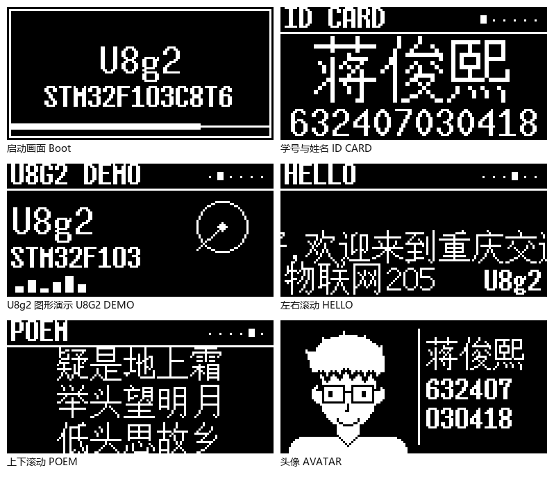

*图 6-1　启动页与五个展示页（左上起：启动、学号姓名；第二行：U8g2 演示、横向滚动；第三行：纵向滚动、头像）*

#### 6.2.1 学号与姓名

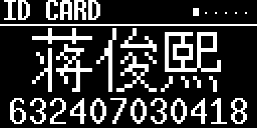

*图 6-2　ID CARD：姓名用 2 倍字号（wqy12 的 2× 绘制），下方是 12 位学号（10×20 字体）*

对应任务 1 的第 1 项和任务 3 的第 2 项：显示自己的学号与姓名。

#### 6.2.2 U8g2 图形演示

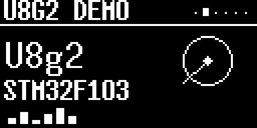

*图 6-3　U8G2 DEMO：`U8g2` 大字、芯片型号、脉冲圆、圆盘、旋转线和 6 段柱状条（均随帧动画）*

对应任务 3 的第 1 项：U8g2 的 demo 例程。

#### 6.2.3 长句左右滚动

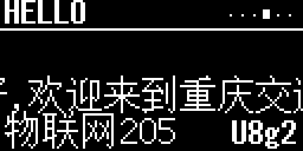

*图 6-4　HELLO 页面：328 px 的长句以 60 px/s 向左滚动，底部固定显示“物联网205 / U8g2”*

对应任务 1 的第 3 项（左右滑动显示长字符）。字模条本身如下（整条 328×16，滚动时只露出 128 列）：


*图 6-5　长句的 328×16 点阵字模条（存入 Flash，656 字节）*

#### 6.2.4 诗句上下滚动

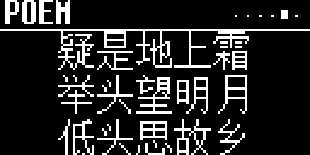

*图 6-6　POEM 页面：《静夜思》四句以 20 px/s 向上滚动，标题区固定不动*

对应任务 3 的第 3 项（上下、左右滑动显示方法）。四句的间距为 18 px，超出标题下方的部分由 `u8g2_SetClipWindow()` 裁掉。

#### 6.2.5 头像与动画


*图 6-7　AVATAR 页面：64×64 头像从右侧滑入，随后每 2.4 s 眨一次眼*

对应任务 3 的第 4 项：显示图案（头像）并带动态效果。

### 6.3 刷新率与 CPU 占用

| 项目 | 数值 |
| --- | --- |
| 每帧数据量 | 1024 B 显存 + 控制/地址开销 ≈ 10.2 kbit |
| I2C 速率 | 400 kHz |
| 单帧传输时间 | ≈ 25 ms |
| 帧间隔 | 40 ms（25 fps） |
| 总线占用 | ≈ 63% |

滚动 60 px/s、25 fps，即每帧移动 2.4 px，肉眼看起来是连续的；头像滑入 600 ms 约 15 帧，动画平滑。

### 6.4 实机验证

工程编译完成后，通过 DAP-Link（CMSIS-DAP）把 `OLED_U8g2_Task.hex` 烧录到实物板，并用 SWD 读回运行状态：

| 检查项 | 结果 |
| --- | --- |
| 烧录 | 镜像约 24 KB（23 页编程 + 1 页内容相同）；读回 `0x08000000 = 0x20000D40`、`0x08000004 = 0x08000189`（初始 MSP 与复位向量，与工程一致） |
| 程序运行 | 多次采样 PC 在 `0x0800051A`～`0x0800301A` 之间变化（HAL、u8g2、主循环），没有停在 `Error_Handler` |
| I2C1 | `hi2c1.Instance = 0x40005400`、`ClockSpeed = 400000`；空闲时 GPIOB 的 SCL/SDA 均为高电平 |
| 显示 | 上电后正常显示 ID CARD（蒋俊熙 / 632407030418）；五个展示页按 5～9 s 自动切换，长句左右滚动、诗句上下滚动、头像滑入 + 眨眼均正常 |

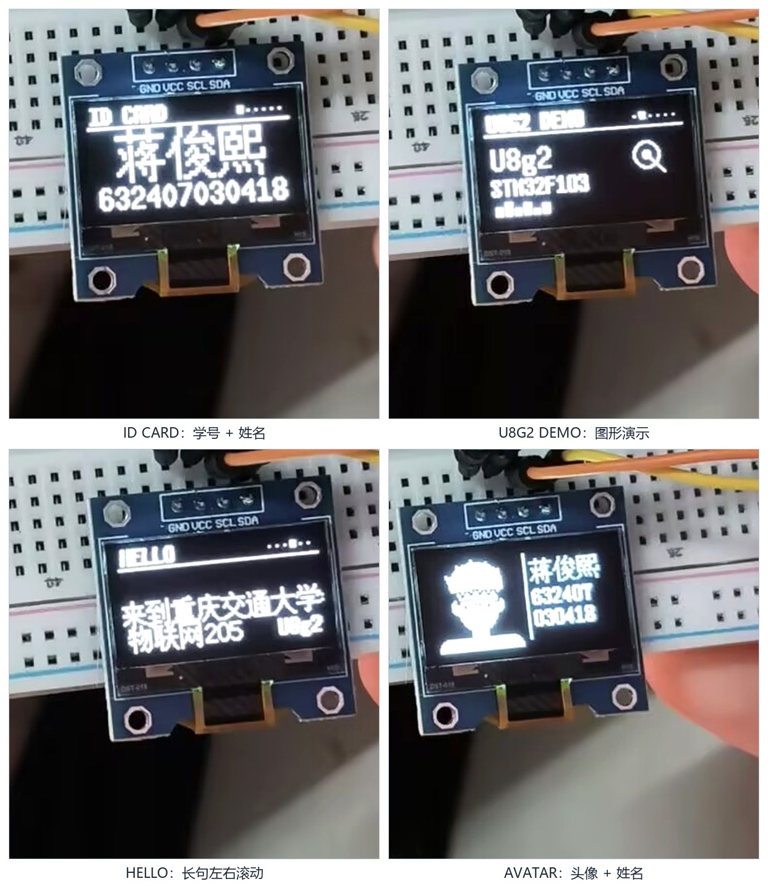

*图 6-8　实机运行照片（ID CARD / U8G2 DEMO / HELLO / AVATAR，DAP-Link 烧录后拍摄）*

> 本节数据来自 2026-10-21 的实机烧录与 SWD 读回。图 6-2～6-7 是按同一套代码和字库离线渲染的界面图（便于在报告中清晰展示），图 6-8 是同一固件在实物上的照片，两者一致。

---

## 七、遇到的问题与解决

| # | 现象 | 原因 | 解决办法 |
| --- | --- | --- | --- |
| 1 | `error: #8: missing closing quote`，报错行指向宏定义之后 | 源文件是 UTF-8，ARMCC 按 GBK 解析；9 字节的“蒋俊熙”被配成 4 个半汉字，最后一个字节把结尾引号吞掉 | C 源文件保持纯 ASCII，中文写成 `\xHH` 转义（`ui_text.h` 由脚本生成） |
| 2 | 链接报 `undefined symbol u8x8_utf8_next / u8g2_GetKerning / u8x8_capture_*` | 裁剪 u8g2 时漏掉了 `u8x8_8x8.c`、`u8x8_capture.c`，且裁剪版 `u8g2_font.c` 缺少两个 kerning 函数 | 补入 `u8x8_8x8.c`、`u8x8_capture.c`；新增 `u8g2_kerning.c` 提供“无 kerning”空实现 |
| 3 | 字库文件编译报 `uint8_t undefined` | 字库 `.c` 文件本身不包含 `u8g2.h`，单独编译时缺少类型和 `U8G2_FONT_SECTION` 宏 | 在三个字库文件开头补 `#include "u8g2.h"` |
| 4 | 长句滚动时 u8g2 画不出来（x 为负） | u8g2 的坐标是 `uint16_t`，负数会回绕成 655xx，被裁掉 | 把整句预渲染成字模条存入 Flash，按列直接写显存，支持任意负偏移 |
| 5 | 全屏刷新慢、滚动卡 | I2C 默认 100 kHz，一帧约 100 ms | I2C1 改为 400 kHz（模块支持），帧间隔 40 ms |
| 6 | 编译有 8 个 `last line of file ends without a newline` 警告 | u8g2 源文件末尾缺换行 | 给相关文件补换行，最终 0 warning |
| 7 | 界面里 `，`、`！` 显示成空白 | 裁剪字库里没有全角标点 | 改用 `,`、`!`；`fontcheck.py` 在生成前检查覆盖率 |
| 8 | 头像直接画会超出屏幕/闪烁 | 逐像素动画没有清屏、x 为负 | 每帧 `u8g2_ClearBuffer()`，滑入阶段 x 限制在 0…128 |

---

## 八、思考题

### 8.1 用 Keil 的虚拟逻辑分析仪采集 I2C 的 SDA 波形，会是什么样子？

**结论：看不到真实的 I2C 波形，SDA/SCL 基本上是一条不变的水平线（高电平），不会有 START、地址、ACK 这些跳变。**

原因有三点：

1. **Keil 的 STM32F1 器件仿真模型只覆盖内核和少量外设**，并不包含 I2C 外设的完整行为模型，更不包含板外的 SSD1306 从机。I2C1 的寄存器在仿真里不会真正驱动引脚；
2. 工程里 PB6/PB7 配置为 **复用开漏（AF_OD）**，引脚由 I2C 外设控制。仿真器不模拟“外设 → 引脚”的这条通路，逻辑分析仪只能看到引脚的复位电平（高阻/上拉后的高电平）；
3. 即使逻辑分析仪能显示 GPIO 的 ODR 位，那也只是“软件写寄存器的值”，不是总线上的真实电平；而且 `HAL_I2C_Master_Transmit()` 在仿真里会因为等不到 TXE/ADDR 等标志而超时，程序根本走不到发数据那一步。

所以，在 Keil 仿真里抓 I2C，最多只能看到一条直线；如果改用**软件模拟 I2C**（GPIO 翻转），逻辑分析仪可以看到 SCL/SDA 的翻转，但那是“软件时序”，不是硬件 I2C 外设的波形，也仍然没有从机应答。

### 8.2 如果采集不到真实的 I2C 协议，可以改用哪些方法？

1. **用真实的逻辑分析仪/示波器**（作业里提到的 SALEAE Logic 16 就是这种）：探头接 PB6、PB7、GND，采样率 ≥ 4 MS/s（400 kHz 的 10 倍以上），触发方式设为“SDA 下降沿”，用软件自带的 I2C 解码器直接解出 `0x78 / 0x00 / 0x40 / 数据`。这是最直接、最可靠的办法。
2. **软件模拟 I2C + 调试打点**：把 I2C 改成 GPIO 位翻转，在每次 SCL/SDA 变化时翻转一个空闲 IO（如 PA0），用示波器同时看 PA0 和 SDA，就能把“代码执行到哪一步”和“总线电平”对应起来；也可以在同一时刻翻转另一个 IO 作为帧起始标记，测出一帧的耗时。
3. **在代码里做“软测量”**：在 `OLED_ByteCb` 的 `END_TRANSFER` 里累加字节数、翻转调试引脚，主循环里统计“每帧多少字节、耗时多少 ms”，通过串口打印出来。本工程按 1024 B / 400 kHz 估算一帧约 25 ms，与这个方法的实测值可以对上。
4. **I2C 扫描/应答测试**：写一个简单的扫描程序，向 0x3C 发地址，检查 `HAL_I2C_IsDeviceReady()` 是否返回 OK。有 ACK 说明地址阶段和从机都正常，能间接证明 I2C 时序正确（SSD1306 是只写器件，没有寄存器可回读）。
5. **用另一块 MCU 当从机**：把 STM32 的 I2C1 配成从机，或直接用另一块单片机模拟 SSD1306 的 ACK，主机端用逻辑分析仪看自己发出的波形，从机端用串口打印收到的字节，两边对照验证。
6. **用 Keil 的 Watch 窗口看寄存器**：单步执行 `HAL_I2C_Master_Transmit()`，观察 `I2C1->CR1/CR2/SR1/SR2/DR` 的变化，虽然看不到波形，但能确认 START 是否发出、地址是否写入、TXE 是否置位、AF 是否报错，从而定位问题。

综合来看，**“真波形”必须用外部仪器**；Keil 仿真适合验证代码逻辑和寄存器配置，不适合验证 I2C 的模拟时序。

---

## 九、结论

1. 完成了基于 STM32F103C8T6 + SSD1306 0.96 寸 OLED 的 I2C 显示系统：硬件 I2C1（PB6/PB7）400 kHz，整屏 1 KB 显存，25 fps 刷新。
2. 成功把 u8g2 裁剪并移植到 HAL 工程：只保留 SSD1306 128×64 I2C 驱动和 3 个字体，Flash 23.2 KB、RAM 3.3 KB，编译 0 error / 0 warning。
3. 实现了五个展示页面：学号姓名、U8g2 图形演示、328 px 长句左右滚动、诗句上下滚动、64×64 头像滑入 + 眨眼动画，覆盖了任务 1 与任务 3 的要求。
4. 掌握了汉字点阵、u8g2 压缩字库、I2C 时序、SSD1306 显存组织、软件/硬件滚动等原理，并解决了 ARMCC 中文编码、裁剪库缺文件、负坐标滚动等实际问题。
5. 遗留：任务 2（AHT20 温湿度）待传感器到货后补充；若要显示更多汉字，需要重新生成字库；长句目前用预渲染字模条，若要做到“任意字符串滚动”，可以把字符串按字符宽度动态排版到一条 1 KB 的环形缓冲中。

---

## 十、参考资料

1. u8g2 官方 Wiki：<https://github.com/olikraus/u8g2/wiki>
2. SSD1306 数据手册（128×64 OLED 驱动 IC）
3. 文泉驿点阵宋体（WenQuanYi Bitmap Song）BDF 字库
4. STM32F103x8/xB 参考手册（RM0008）、STM32F1 HAL 库文档
5. 课程参考：<https://blog.csdn.net/qq_45237293/article/details/111712565>
6. 课程参考：<https://blog.csdn.net/qq_43279579/article/details/111414037>
7. 基于 STM32 移植 U8g2 图形库——OLED 显示（HAL 库）：<https://blog.csdn.net/black_sneak/article/details/126312657>
8. 中景园电子 0.96 寸 OLED 使用文档、原理图与测试程序（课程资料）

---

## 附录 A　文件清单

| 文件 | 说明 |
| --- | --- |
| `Core/Src/app.c` | 页面状态机、帧率控制、LED 心跳 |
| `Core/Src/ui.c` | 五个页面的绘图实现（标题栏、进度条、滚动、头像动画） |
| `Core/Src/ui_assets.c` | 64×64 头像位图（512 B）+ 328×16 滚动字模条（656 B） |
| `Core/Src/oled_port.c` | u8g2 → HAL I2C 的 byte / gpio 回调、`OLED_Init/Refresh` |
| `Core/Inc/ui_text.h` | 中文文本的 UTF-8 转义定义（自动生成） |
| `Middlewares/u8g2/` | 裁剪后的 u8g2 源码（28 个 .c） |
| `Middlewares/u8g2/fonts/` | 7×14B / 10×20 ASCII、wqy12 汉字子集 |
| `docs/STM32_OLED_U8g2实验报告.md` | 本报告源码 |
| `docs/STM32_OLED_U8g2实验报告.pdf` | 本报告 PDF |
| `docs/images/` | 接线图、框图、时序图、界面截图等全部插图 |
| `docs/tools/fontcheck.py` | 检查界面文本是否被字库覆盖 |
| `docs/tools/gen_text.py` | 生成中文文本头文件（UTF-8 转义） |
| `docs/tools/gen_assets.py` | 生成头像位图和滚动字模条 |
| `docs/tools/render_screens.py` | 用真实字库渲染界面图（本报告插图） |
| `docs/tools/make_figs.py` | 生成接线图、框图、时序图、流程图 |

## 附录 B　编译与烧录

```powershell
# 编译（Keil 命令行）
$uv = 'C:\Users\Administrator\Desktop\STM\UV4\UV4.exe'
Start-Process $uv -ArgumentList @('-r', 'MDK-ARM\OLED_U8g2_Task.uvprojx',
                                  '-j0', '-o', 'build.log') -Wait

# 产物
# MDK-ARM\OLED_U8g2_Task\OLED_U8g2_Task.hex
# MDK-ARM\OLED_U8g2_Task\OLED_U8g2_Task.axf
```

烧录：DAP-Link → SWD（3V3、GND、SWDIO-PA13、SWCLK-PA14），Keil 选择 CMSIS-DAP 后按 F8；或者用 FlyMcu 通过 USART1（PA9/PA10）ISP 下载。

## 附录 C　字库字符表

ASCII 部分（95 个）：`0x20`–`0x7E`，即空格、数字、大小写字母和常用标点。

汉字/符号部分（46 个）：

```text
上 业 举 乡 交 低 作 你 俊 光 到 前 号 名 地 大 头 好 姓 学 实 室 庆 床 度
思 故 明 是 月 望 来 欢 温 湿 熙 物 疑 网 联 蒋 训 迎 通 重 霜
```

它们覆盖了本报告涉及的界面中文：姓名“蒋俊熙”、标签“学号”、长句“你好，欢迎来到重庆交通大学物联网205实训室！”以及《静夜思》的“床前明月光 / 疑是地上霜 / 举头望明月 / 低头思故乡”。

---

*报告完*
